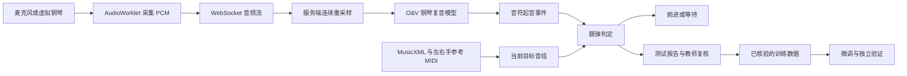

# PianoVal

**面向钢琴教学的 AI 听音、跟弹与评测工作台。**

PianoVal 将浏览器录音、WebSocket 流式传输、钢琴复音识别、曲谱对照和人工复核连接起来，帮助教师测试学生的左手、右手与双手演奏，也帮助开发者定位漏音、误识别、误拦和反馈延时。

项目提供可自行部署的 Python 服务、浏览器工作台和虚拟钢琴测试工具。识别模型在服务端运行，不依赖付费大模型 API。

[GitHub](https://github.com/shenmashi/PianoVal) · [Gitee](https://gitee.com/mashi/piano-val) · [Apache-2.0：项目自有代码](LICENSE) · [第三方授权](THIRD_PARTY_NOTICES.md)

> 当前属于实验与评测阶段。真实钢琴、房间混响、设备麦克风及服务器负载都会影响结果；尚未完成真实学生场景下 95% 准确率与生产并发验收。

## 能做什么

| 功能 | 说明 |
| --- | --- |
| 浏览器实时听琴 | 通过麦克风采集单声道 PCM，经 WebSocket 发送给服务端模型 |
| 钢琴复音识别 | 输出 MIDI 音高、起音时间、力度估计与模型起音概率 |
| 左手 / 右手 / 双手跟弹 | 根据所选声部的参考 MIDI 构建目标音组；不是通过麦克风判断实际使用了哪只手 |
| 等待式跟弹 | 当前音组匹配后前进；缺音、错音和多音时等待，不因时间流逝自动跳步 |
| 误拦后的人工恢复 | 支持“放行当前音组”和“从下一小节继续”，录音不中断；人工操作单独记录 |
| 曲谱与键盘联动 | 五线谱游标、水平跟随、MIDI 示范及琴键高亮 |
| 虚拟钢琴自动测试 | 可手动按键，也可一键完全正确弹、随机错误弹和随机曲目测试 |
| 录音与标注 | 上传、回听录音，编辑实际演奏音符，导入 MIDI 标注并由人工确认 |
| 模型微调 | 基于预训练模型微调，训练 / 验证分离，比较候选模型并支持切回基础模型 |
| 排错与历史记录 | 保存测试报告、可选录音和逐窗日志，查看误拦、误放行及延时分位数 |
| 登录与退出 | 可选的 Cookie 登录、多账号配置与当前浏览器退出 |

当前包含 14 首曲目、17 个曲谱版本及配套 MusicXML、左右手 MIDI、谱面和伴奏资源。资源保留校验值和来源说明；原始资源服务器地址在公开版本中已替换为示例域名。曲谱与音频不属于项目自有代码的 Apache-2.0 授权范围。

## 工作原理



“应该弹什么”来自结构化曲谱与参考 MIDI；“实际弹了什么”来自模型对录音的识别。伴奏供试听使用，不直接充当学生演奏的答案。

跟弹使用确定性的音高集合匹配。人工放行只改变练习位置，不修改原始模型输出，也不计作识别正确。普通测试不会自动更新模型权重；微调需要人工核验的真实音符标注。

## 快速开始

推荐先运行 `server/` 工作台。它自带浏览器页面，不需要先构建根目录的 Vue 原型。

需要 Python 3.11 或 3.12 和 [uv](https://docs.astral.sh/uv/)。

```bash
git clone https://github.com/shenmashi/PianoVal.git
cd PianoVal/server

# 安装锁定依赖，下载并校验预训练权重
uv sync --locked
uv run python scripts/download_model.py

# 默认仅监听本机
uv run uvicorn app.main:app --host localhost --port 8765 \
  --ws-max-size 65536 --ws-max-queue 16
```

国内也可从 Gitee 克隆：

```bash
git clone git@gitee.com:mashi/piano-val.git
```

首次启动需要下载约 12 MB 的 O&V 权重。下载脚本固定上游版本并校验 SHA256，模型文件不提交到 Git。

| 入口 | 地址 |
| --- | --- |
| 录音、标注和训练工作台 | `http://localhost:8765/` |
| 真实钢琴跟弹 | `http://localhost:8765/#practice` |
| 虚拟钢琴测试 | `http://localhost:8765/#piano` |
| 操作说明 | `http://localhost:8765/#guide` |
| 服务状态 / 模型就绪 | `/health` / `/ready` |
| WebSocket | `ws://localhost:8765/ws/transcribe` |

本地开发默认不启用账号登录。部署时请自行配置账号与密码哈希；仓库不包含实际服务器账号、教师录音、登录会话或生产环境配置。

## 教师怎样测试

1. 打开“曲谱实测”，选择曲目、版本、声部和小节范围。
2. 声音来源选“麦克风实弹”，模式选“听音辅助（跟弹等待）”。
3. 点击“开始听琴”，允许麦克风，在页面提示就绪后弹奏。
4. 缺音、多音或错音时查看当前目标与最近识别；疑似误拦可点击谱面上方的放行入口继续演奏。
5. 点击“结束并对照”，回听录音并标记“实际弹对，应通过”或“实际有错，应等待”。
6. 在测试历史中查看完整报告与排错日志。

没有钢琴时，可打开“虚拟钢琴”，选择“完全正确弹”或“随机错误弹”。采样声音经过真实 PCM、WebSocket 和模型链路，按键记录仅用于独立对照，不作为模型答案。

**虚拟钢琴测试验证的是模拟音频链路，不能代替真实教室和 Pad 麦克风测试。**

## 训练与准确率

上传录音后，可先进行识别和复核；监督微调还需要实际演奏的音符标签。标签应记录学生真正弹出的音，包括错音，不能直接把目标曲谱当成所有录音的标准答案。

使用训练集微调，在独立验证集上检查精确率、召回率和音符 F1，再用未参与调参的真实录音测试候选模型。项目提供候选试用和基础模型回退，详见工作台“使用说明”。

| 指标 | 含义 |
| --- | --- |
| 音符精确率 / 召回率 / F1 | 识别音符与经过核验的实际演奏标注之间的匹配情况 |
| 逐组判断正确率 | 有独立实际输入答案时，正确放行与正确拦截所占比例 |
| 老师复核判对率 | 仅覆盖教师已经复核的判定，不代表整段实弹准确率 |
| 跟弹进度 | 已推进的谱面音组；人工放行单独统计，不能充当识别准确率 |

## 延时与并发

默认识别配置为 16 kHz 模型输入、192 ms 音频推进步长、288 ms 右侧上下文和约 20 ms 浏览器发包间隔。跟弹还需等待起音分组窗口完整，才能作出判定。

**上述参数均不等于端到端反馈延时。** 需要同时观察采集、上行传输、服务端积压、模型推理、下行传输和浏览器判定。工作台记录分析滞后、推理耗时、同连接往返、发包缓冲及判定耗时，并汇总 P50 / P95 / 最大值。

当前服务默认限制 2 路识别连接，使用单个推理工作线程。连接上限不代表实时承载能力：若处理一段音频的计算时间大于该段音频时长，积压会持续增长；生产环境需对目标机器单独压测。

## Pad 与部署

Pad 麦克风访问需要有效 HTTPS 和对应的 WSS。`localhost` 的本机例外不适用于从 Pad 访问另一台电脑；忽略自签名证书警告也不等于完成证书信任。

使用反向代理，将网页、API 和 WebSocket 放在同一来源，并持久化数据目录。示例、登录配置和日志说明见 [部署指南](docs/DEPLOYMENT.md)。

内部配置采用 `PIANOVAL_` 环境变量，常用项包括：

```dotenv
PIANOVAL_DEVICE=cpu
PIANOVAL_THRESHOLD=0.74
PIANOVAL_MEL_OFFSET_DB=-22
PIANOVAL_LEFT_FRAMES=100
PIANOVAL_STEP_FRAMES=8
PIANOVAL_RIGHT_FRAMES=12
PIANOVAL_MAX_SESSIONS=2
PIANOVAL_MAX_AUDIO_SECONDS=600
```

更多参数见 [服务端配置](server/.env.example)。下载后的权重、录音、标注、训练任务与历史报告默认留在本机，不上传到代码仓库。

## 项目结构

```text
PianoVal/
├── server/
│   ├── app/               # WebSocket、模型适配、录音、训练、报告和认证
│   ├── static/            # 浏览器工作台、曲谱、钢琴采样与谱面渲染器
│   ├── scripts/           # 模型下载、WAV 联调、基准测试及日志查看
│   ├── tests/             # 服务协议、跟弹逻辑和浏览器回归
│   ├── vendor/            # 保留原授权的 O&V 上游源码
│   └── pyproject.toml
├── src/                   # 独立 Vue 单音识别原型
├── tests/                 # Vue 原型测试
├── docs/                  # 项目介绍和通用部署指南
├── THIRD_PARTY_NOTICES.md
└── LICENSE
```

根目录 Vue 原型使用 Web Audio 与 YIN 单音估计，适合体验基础录音与音符对照；完整复音识别、训练和跟弹功能位于 `server/`。

```bash
# 可选：运行独立 Vue 原型，需要 Node.js 22+ 和 pnpm
pnpm install --frozen-lockfile
pnpm dev
pnpm build
pnpm test
```

## 开发验证

```bash
cd server
uv run pytest -q
node --test tests/*.test.mjs

# 将自己的 WAV 送入本地流式识别服务
uv run python scripts/stream_wav.py /path/to/piano.wav --realtime
```

浏览器回归使用 Playwright；涉及登录的脚本通过 `PIANOVAL_TEST_USERNAME` 与 `PIANOVAL_TEST_PASSWORD` 读取测试账号，不内置部署账号。

## 当前限制与改进方向

- 钢琴泛音、延音踏板、混响、人声、快速连奏和轻音可能导致额外八度音或漏音，严格跟弹仍可能误拦。
- 当前主要识别音符起音与 MIDI 音高，不评估琴键调音偏差的音分，也不完整评估松键、踏板、表情或教学等级。
- 账号共用工作区，尚未实现教师 / 学生数据隔离与完整角色权限。
- CPU 吞吐、真实设备准确率、持续跟谱恢复和高并发推理仍需改进。
- 欢迎贡献有授权的真实标注数据、可复现的误拦案例、模型适配器和延时优化。

提交问题时请附曲目 / 声部 / 片段、模型配置和脱敏日志；录音应取得相关人员授权。

## 许可证与致谢

PianoVal 自有代码采用 [Apache License 2.0](LICENSE)。第三方代码、模型、采样和曲谱保留各自的许可证或权利声明，Apache-2.0 不覆盖这些内容。

- **Onsets & Velocities**：Andrés Fernández Rodríguez / IAMúsica，预训练钢琴模型；随附源码采用 GPL-3.0，保留完整许可证与上游说明。将其与本项目组合分发时，还需满足 GPL-3.0 的要求。
- **OpenSheetMusicDisplay**：五线谱渲染，BSD-3-Clause。
- **Salamander Grand Piano**：Alexander Holm，钢琴采样，CC BY 3.0。

完整来源、固定版本、权重校验和与授权范围见 [第三方声明](THIRD_PARTY_NOTICES.md) 和 [服务端第三方说明](server/THIRD_PARTY_NOTICES.md)。
